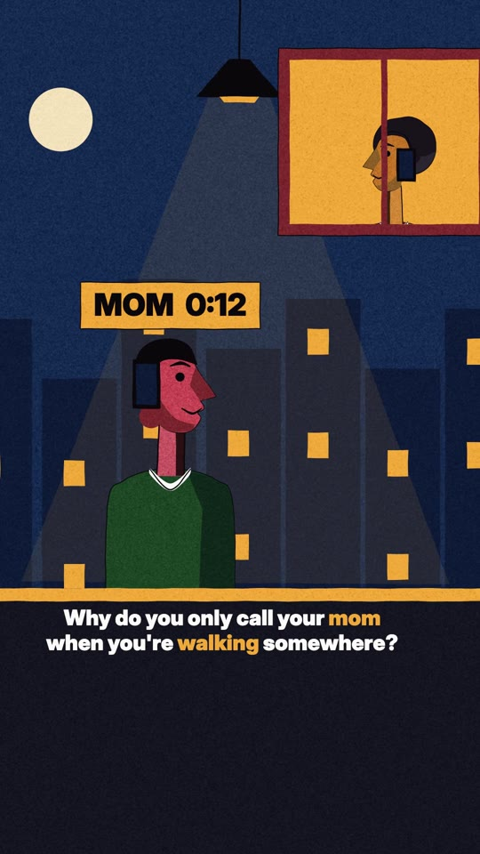
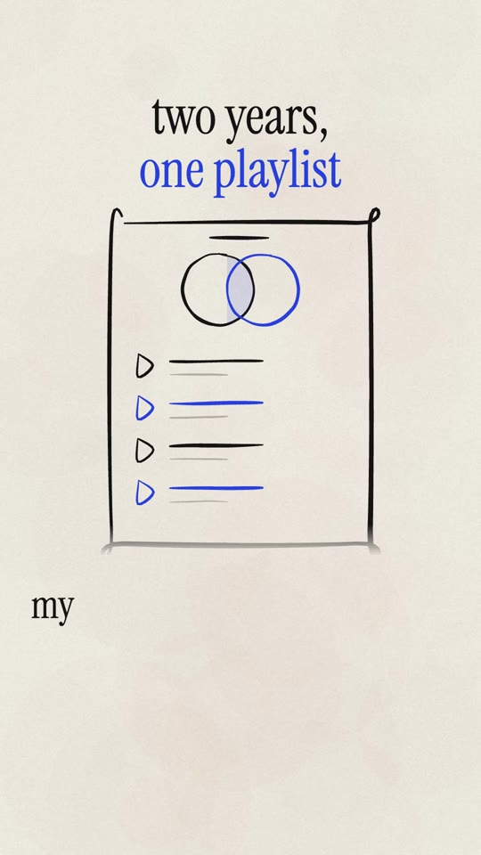
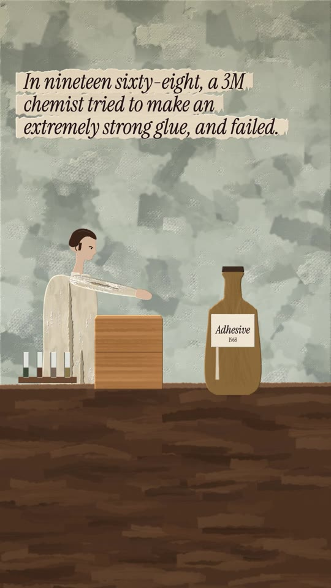
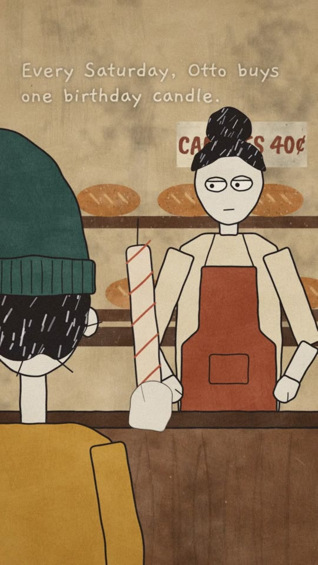

# open-papertrail

**Vertical videos drawn entirely in code, written and directed by Claude Code, voiced on your own Mac.**

You type `/make a video about why we only call our moms while walking` in Claude Code. Claude pitches ideas, a separate
critic agent kills the weak ones, then it writes the script, voices it locally, draws every frame in TypeScript on a
canvas, renders, mixes the sound and runs QA. You get a finished 1080x1920 MP4 with captions, an `.srt` and a caption
for posting.

Nothing runs on anyone's servers. It uses **your Claude subscription** (through Claude Code) for the writing and the
drawing code, and **your Mac** for the voice and the render. No API keys, no accounts, no GPU rental.

| | Style | What it's for | Example |
|---|---|---|---|
|  | **flat-grain** | Relatable explainers: a felt question, a plain answer, a last line that turns it back on you. Flat inks, hard shadows, grain. | [`walk.mp4`](examples/flat-grain/walk.mp4) |
|  | **ink-line** | First-person stories with no characters on screen: the objects carry it. One brush line on bone paper, cobalt for the narrator's inner life. | [`blend.mp4`](examples/ink-line/blend.mp4) |
|  | **knife-paint** | True chains of events from history and science, fact-checked with sources. A palette-knife acrylic painting that moves. | [`sticky.mp4`](examples/knife-paint/sticky.mp4) |
|  | **painted** | Deadpan third-person comedy: an ordinary errand where one thing is wrong. Gouache sets, inked characters, a painted overlay. | [`candles.mp4`](examples/painted/candles.mp4) |

Every example was made with this repo's own pipeline. Their full sources are in `styles/<style>/examples/<slug>/`:
script, storyboard, `scene.ts` and `sound.ts`. Read them to see how a video is built.

## Quick start (5 minutes, no voice setup)

```bash
git clone https://github.com/<you>/open-papertrail && cd open-papertrail
npm install
npm run doctor          # checks Node, ffmpeg, Chrome; tells you what's missing
claude                  # start Claude Code in this folder
```
Then, in Claude Code:
```
/make ink-line a story about a shared calendar
```
### What happens next
1. Claude reads the style's rules, writes ~10 ideas, and a separate critic agent keeps the best 1-3. **You pick one**
   (or say "auto" in your request and it picks).
2. It writes the script. **You approve it** or ask for changes.
3. Then it works on its own: voice, drawing code, preview stills checked against the style's design rules, render, QA.
4. You get `styles/ink-line/episodes/<date>-<slug>/<slug>.mp4` plus `caption.txt` to post with.

A 25-second video takes roughly 20-40 minutes end to end on a recent Mac, most of it Claude writing and fixing the
drawing code. Rendering is 1-3 minutes. You can stop at any point and edit any file by hand: every step is a plain
file in the episode folder.

Without any setup the voice is **Kokoro**, a small free voice model that runs on the CPU. For the much better
**Qwen3-TTS** voices (cloned from the six voices in `voices/`), do the one-time setup in [SETUP.md](SETUP.md); on an
Apple Silicon Mac it takes about ten minutes.

## What you need
- **Claude Code** with a Claude subscription (Pro or Max) or an API key. That's the only paid thing, and it's yours.
- **Node 20+** and **Google Chrome** (or `npm run setup:chrome` downloads a headless one). ffmpeg comes with `npm install`.
- **For the Qwen voices:** an Apple Silicon Mac (M1 or newer), Python 3.10+, ~5 GB of disk for the models. 8 GB of RAM works.

## How it works
```
idea ─► /pitch ─► critic agent ─► /write ─► voice ─► timeline ─► /animate ─► look-checker agent ─► /finish
         ~10 ideas   kills most     script +   local    shots      scene.ts +   checks every still    render, mix,
                     keeps ≤3       storyboard Qwen or  snapped    sound.ts     against DESIGN.md     export, QA
                                               Kokoro   to words
```
- **Skills** (`.claude/skills/`): `/make` runs the whole thing; `/pitch`, `/write`, `/animate`, `/finish` are the
  stages; `/new-style` builds your own look; `/new-character` designs a character for the painted style.
- **Agents** (`.claude/agents/`): `critic` judges pitches it never saw being written; `look-checker` judges stills with
  fresh eyes. They run in their own context, so they aren't biased by the work they check.
- **Engine** (`core/`): the CLI the skills call. Each step reads and writes plain files in the episode folder, so you
  can stop, edit anything by hand, and continue. See [core/README.md](core/README.md).

## Commands
```bash
npm run studio -- new --style ink-line --slug my-idea   # styles/ink-line/episodes/<date>-my-idea/
npm run studio -- voice my-idea       # voice.mp3 + words.json (Qwen if running, else Kokoro)
npm run studio -- timeline my-idea    # shots from storyboard.json snapped to the spoken words
npm run studio -- stills my-idea --preview   # a still from the middle of every shot
npm run studio -- render my-idea      # video.mp4 (picture), headless Chrome + ffmpeg
npm run studio -- score my-idea       # sound effects from sound.ts
npm run studio -- export my-idea      # my-idea.mp4 at -14 LUFS, .srt, caption.txt
npm run studio -- qa my-idea          # length, hook timing, pace, safe zones, sync, sources
npm run studio -- list                # your episodes and the examples
```

## Make it yours
- **Your own voice:** describe one and Qwen designs it (`voices/README.md`), or drop in a recording you own.
- **Your own style:** `/new-style`. Everything is drawn on a canvas, so flat, graphic, painterly and textured looks
  work well; photoreal doesn't.
- **Your own lead character** in the painted style: `/new-character`.

## Licenses
Code: [MIT](LICENSE). Fonts: SIL Open Font License ([FONTS.md](FONTS.md)). Voices: synthetic, designed from text
descriptions, CC0 ([voices/README.md](voices/README.md)). Models you download at setup keep their own licenses:
Qwen3-TTS and Kokoro are Apache-2.0, Whisper (for word timings) is MIT.

Videos you make are yours. Don't use this to imitate a real person's voice or face without their permission.
